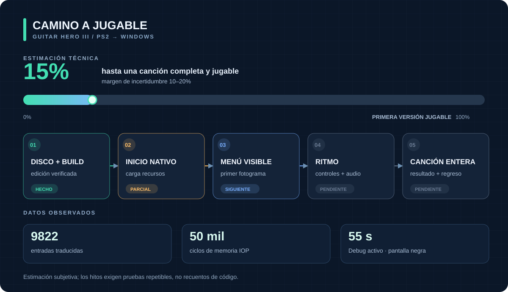

# Guitar Hero III · Port nativo para Windows

[English](README.md) · [Português (Brasil)](README.pt-BR.md) · **Español**

Port nativo experimental de **Guitar Hero III: Legends of Rock** para PlayStation 2, centrado en la edición USA/NTSC **SLUS-21672**. El primer objetivo jugable es completar una canción con audio sincronizado, controles y resultados.

> **Estado: el prototipo abre una ventana negra. No se han verificado menú ni versión jugable.**

**Debes poseer una copia original del juego y aportar tu propia imagen del disco.** Este repositorio no incluye ejecutable, ISO, canciones, vídeos, texturas ni archivos extraídos del juego. Es un proyecto no oficial, sin relación con Activision, Neversoft, RedOctane ni los titulares de derechos.

Este fork utiliza [PS2Recomp](https://github.com/ran-j/PS2Recomp) para traducir el ejecutable principal de PS2 a C++ y ejecutarlo mediante un runtime experimental de compatibilidad. Conserva el historial original y la licencia GPL-3.0. El desarrollo ha utilizado OpenAI Codex para código, análisis y documentación; los resultados proceden de pruebas locales y requieren validación independiente.

## Progreso comprobado

| Área | Resultado |
| --- | --- |
| Disco | El ejecutable local `SLUS_216.72` coincidió con el SHA-1 esperado. |
| Traducción | El mapa híbrido generó 9822 entradas, incluidos 84 stubs del runtime. |
| Inicio | La compilación Debug cargó módulos IOP, archivos y scripts del juego. |
| Compilación | Se observó un ejecutable Release local durante 55 segundos; no hay menú ni canción confirmados. |
| Memoria | La prueba del asignador IOP superó 50 000 ciclos de asignación/liberación. |
| Pantalla | Una ejecución Debug de 55 segundos mostró una ventana negra. No hay menú ni canción confirmados. |

El ajuste temporal del IOP y las respuestas anticipadas de apertura son aproximaciones. Gráficos, audio, controles y sincronización siguen pendientes. Consulta las [notas técnicas](gh3-port/docs/TECHNICAL_STATUS.md).

## Camino a una versión jugable

**El 15% es una estimación técnica subjetiva**, con un margen plausible del 10–20%. Tiene en cuenta la identificación del disco y el inicio nativo parcial; aún no se han demostrado imagen, menú, audio sincronizado, controles ni una canción completa. No mide la cobertura del código ni predice una fecha de entrega. [ROADMAP.md](ROADMAP.md) define las pruebas de cada hito.

## Estructura y compilación

`gh3-port/scripts/` contiene extracción local, mapas y diagnósticos; `gh3-port/src/` contiene diagnósticos del host; `gh3-port/tests/` contiene pruebas del runtime. Los cambios del runtime están en `ps2xIOP/` y `ps2xRuntime/`. El código generado, los datos del disco, los registros y las compilaciones quedan fuera de Git.

Es un **prototipo para desarrolladores en Windows x64**. Requiere Visual Studio 2022 con C++, CMake, Git, Python 3 y una ISO local de la edición indicada. Sigue la [guía de compilación](gh3-port/docs/BUILD.md). Aún falta validar una compilación completa desde un clon limpio.

Mantenido por [Iago Gomes](https://github.com/omesis-sec), quien ya publicó [pruebas y documentación de un port en Intel UHD](https://github.com/omesis-sec/cybersecurity-portfolio/blob/main/docs/spartanport-validation.md). El [proyecto de descompilación de GH3](https://github.com/Ketbome/gh3-decomp) proporciona el mapa de funciones usado localmente; su código y los datos del juego no se redistribuyen aquí. Las contribuciones deben incluir observaciones reproducibles sin archivos del juego ni rutas personales.

## Aviso legal

Este es un proyecto independiente y no oficial de preservación e interoperabilidad. Ni el proyecto ni su responsable están afiliados, patrocinados, respaldados o actúan en nombre de ninguna desarrolladora, editora, empresa de plataformas u otro titular de derechos, incluidas Activision, Neversoft, Budcat Creations, RedOctane y Sony Interactive Entertainment. Los títulos, nombres de empresas y marcas se usan únicamente para identificar el juego y pertenecen a sus respectivos titulares.

Este repositorio no proporciona, aloja ni distribuye el juego, su imagen de disco, ejecutable, canciones, vídeos, texturas u otros datos propietarios. Para usar el proyecto, debes disponer de una copia original obtenida legalmente de la edición compatible de PlayStation 2 y preparar tus propios archivos locales conforme a la legislación aplicable. El responsable no proporciona copias del juego ni ayuda a obtener copias no autorizadas. El código y la documentación son para investigación y desarrollo; actualmente no hay una versión jugable disponible.
