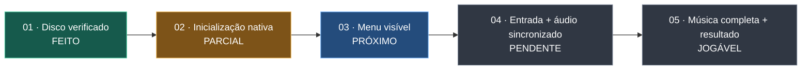

# Guitar Hero III · Port nativo para Windows

[English](README.md) · **Português (Brasil)** · [Español](README.es.md)

Port nativo experimental de **Guitar Hero III: Legends of Rock** para PlayStation 2, voltado à edição USA/NTSC **SLUS-21672**. O primeiro marco jogável será completar uma música com áudio sincronizado, entrada e resultado.

> **Estado: o protótipo abre uma janela preta. Ainda não há menu nem build jogável verificados.**

**Você precisa possuir uma cópia original do jogo e fornecer sua própria imagem do disco.** Este repositório não fornece executável, ISO, músicas, vídeos, texturas ou arquivos extraídos do jogo. O projeto é não oficial e não tem vínculo com Activision, Neversoft, RedOctane ou os titulares dos direitos.

Este fork usa [PS2Recomp](https://github.com/ran-j/PS2Recomp) para traduzir o executável principal do PS2 em C++ e executá-lo com um runtime experimental de compatibilidade. O histórico original e a licença GPL-3.0 são preservados. O desenvolvimento utilizou OpenAI Codex em código, análise e documentação; os resultados abaixo vêm de testes locais e exigem validação independente.

## Progresso verificado

| Área | Resultado |
| --- | --- |
| Disco | O executável local `SLUS_216.72` coincidiu com o SHA-1 esperado. |
| Tradução | O mapa híbrido gerou 9.822 entradas, incluindo 84 stubs do runtime. |
| Inicialização | A build Debug carregou módulos IOP, arquivos e scripts do jogo. |
| Memória | O teste do alocador IOP passou em 50 mil ciclos de alocação/liberação. |
| Tela | A última execução observada durou 55 segundos, com janela preta. Não há menu ou música confirmados. |

A temporização do IOP e as respostas antecipadas de abertura ainda são aproximações. Gráficos, áudio, entrada e sincronização continuam pendentes. Consulte as [notas técnicas](gh3-port/docs/TECHNICAL_STATUS.md).

## Caminho até uma versão jogável

O gráfico acompanha marcos observáveis, sem inventar uma porcentagem de conclusão. [ROADMAP.md](ROADMAP.md) define os critérios de cada marco.

## Estrutura e compilação

`gh3-port/scripts/` contém extração local, mapas e diagnósticos; `gh3-port/src/` contém diagnósticos do host; `gh3-port/tests/` contém verificações do runtime. As alterações do runtime ficam em `ps2xIOP/` e `ps2xRuntime/`. Código gerado, dados do disco, logs e compilações ficam fora do Git.

Este é um **protótipo para desenvolvedores em Windows x64**. Requer Visual Studio 2022 com C++, CMake, Git, Python 3 e uma ISO local da edição indicada. Siga o [guia de compilação](gh3-port/docs/BUILD.md). Ainda não foi validada uma compilação completa de um clone limpo.

Mantido por [Iago Gomes](https://github.com/omesis-sec), que já publicou [testes e documentação de port em Intel UHD](https://github.com/omesis-sec/cybersecurity-portfolio/blob/main/docs/spartanport-validation.md). O [projeto de descompilação de GH3](https://github.com/Ketbome/gh3-decomp) fornece o mapa de funções usado localmente; seu código e os dados do jogo não são redistribuídos aqui. Contribuições devem trazer observações reproduzíveis, sem arquivos do jogo ou caminhos pessoais.
